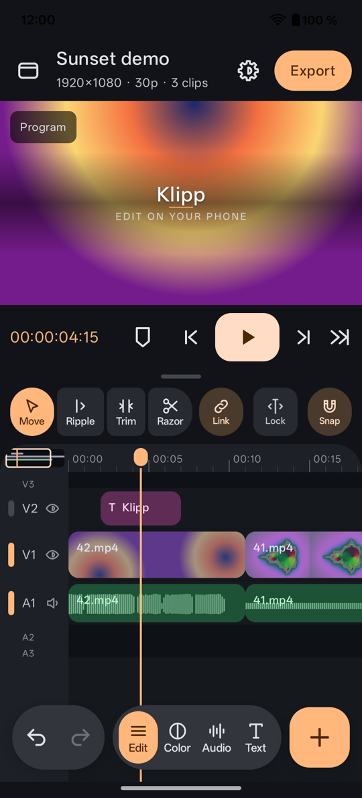
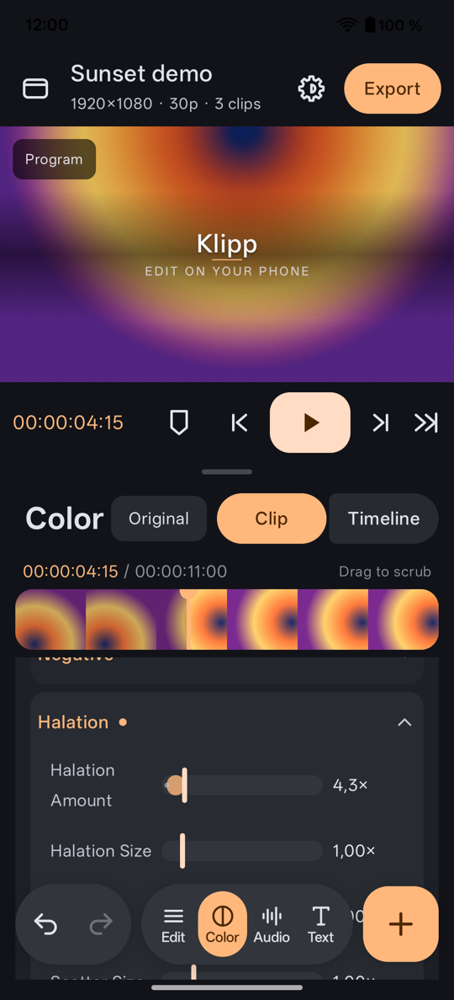
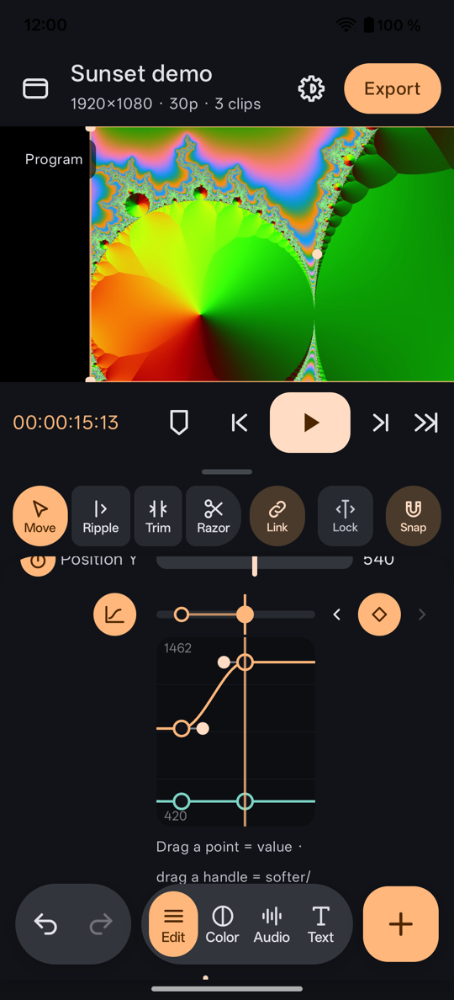
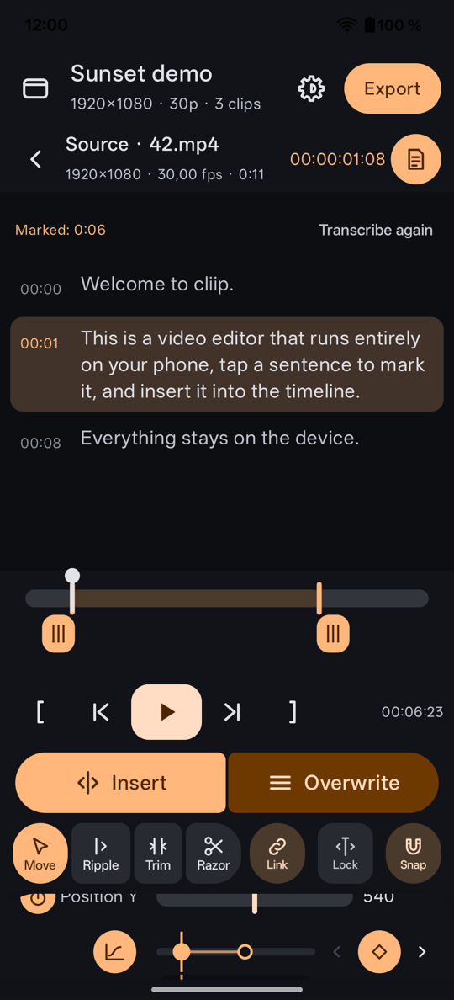

# 🎬 Klipp

A multi-track video editor for Android phones, built for touch. A Kotlin/Jetpack Compose app on top of the
[FilmCraft](https://github.com/storytold/filmcraft) editing engine (Rust, via JNI); playback and export with Media3.

<p align="center">
  
  
  
  
</p>

> 🚧 **Status:** a hobby project in active development. Android 10+ (arm64). Tested on a **vivo X300 Ultra** and a
> **OnePlus 12**. It comes with **no warranty** – keep copies of footage you care about. Issues are welcome; support is
> best effort.

## ✨ Features

- ✂️ **Editing:** three video and three audio tracks, insert/overwrite from a source monitor, ripple, roll, slip,
  razor, linked audio, compound clips, markers, undo/redo for everything.
- 👆 **Touch first:** swipe down through a clip to cut it, drag a clip up out of the timeline to delete it, drag any
  edge to trim (with a loupe and a two-frame trim view), long-press to lift, pinch to zoom; scrub on the ruler or the
  picture and slide the finger down for ½, ¼, ⅛ speed; two-finger tap = undo, three = redo.
- 📝 **Text-based editing:** on-device speech recognition (whisper.cpp with voice activity detection; Swedish,
  English and multilingual models in three quality steps) turns the audio into text. In the timeline: delete words to
  cut the video, remove pauses and filler words. In the source monitor: read a clip as sentences and tap the ones you
  want to insert – one transcript per clip, shared by both. Automatic captions.
- 🎨 **Color:** node-based grading (wheels, curves, qualifiers, power windows with object tracking), LUTs, scopes,
  spektrafilm film simulation, OpenDRT, floating point through the whole video chain. Log input from phones and
  cinema cameras: Apple Log, vivo Log, S-Log3, V-Log, LogC3/LogC4, F-Log2, Log3G10, DaVinci Intermediate, ACEScct, T-Log.
- 🎞️ **Video layers:** transitions, titles and templates, captions, blend modes, masks with keyframes and tracking,
  keyframed motion, opacity and volume – linear, easy ease, ease in/out or hold, and a value graph with bezier
  handles (evaluated with the engine's own curve math, so preview and export match).
- 🎧 **Audio:** mixer with automation, effects (noise reduction, speech enhance, EQ, compressor …), auto ducking,
  loudness measurement, voice-over, downloadable sound effect packs.
- ⚡ **Performance:** proxies, pre-rendering of heavy parts, render cache, HDR and 10-bit.
- 🔒 **Private:** nothing leaves the phone: speech recognition and all processing run locally; the network is only used to
  download speech models and sound packs you ask for.

## 📁 Project layout

- `app/` – the Android app (Compose, Media3 for playback and export)
- `rust/` – `klipp-bridge`, the JNI bridge to FilmCraft (`Session::execute`)
- `third_party/` – Media3 effect (modified), whisper.cpp (trimmed), the Silero VAD model – see `THIRD_PARTY.md`

## 🌍 Languages

English (default) and Swedish. Translations live in `app/src/main/res/values-*/` (Swedish in `values-sv/`); the
app language can be chosen per app in the system settings (Android 13+).

## 🎞️ Video layers

- **Export:** Media3 Transformer with the multi-layer compositor (`LayerCompositor`): V3 → V2 → V1 plus cross dissolve
  layers, titles and captions as overlays (`TimedOverlay`), templates and animations in `Titles.kt`.
- **Preview:** Media3's CompositionPlayer doesn't support multiple video sequences yet, so the main player shows the
  bottom layer and `UpperLayers` draws the upper layers (their own muted ExoPlayers in a TextureView, synced to the
  playhead), titles and captions on top. While you drag a slider, `LivePreview` draws a still frame.
- Long-press "Program" in the viewer for a diagnostics view.

## 🛠️ Building

Requirements: Android Studio (or SDK + JDK 21), Rust (rustup), Android NDK.

1. Install the Rust target and cargo-ndk (once):

   ```
   rustup target add aarch64-linux-android
   cargo install cargo-ndk
   ```

2. Build the Rust bridge into `app/src/main/jniLibs` (about 10–20 min the first time). The built library is not in the
   repository; GitHub Actions builds it on every push (`.github/workflows/build.yml`) and keeps the APK as an artifact:

   ```
   cd rust
   export ANDROID_NDK_HOME=$HOME/Library/Android/sdk/ndk/<version>
   RUSTFLAGS="--remap-path-prefix=$HOME=~" cargo ndk -t arm64-v8a --platform 29 -o ../app/src/main/jniLibs build --release
   ```

3. Open the project in Android Studio and run, or build from the terminal:

   ```
   ./gradlew assembleDebug
   ```

### 🔑 Signing

Android only updates an installed app with an APK signed by the same key. The release build reads its key from
`~/.klipp/keystore.properties` (outside the repository; or a file named by the `KLIPP_KEYSTORE` environment variable):

```
storeFile=/path/to/klipp-release.jks
storePassword=…
keyAlias=klipp
keyPassword=…
```

Without it (e.g. on CI) the release build is signed with the debug key. `-Pklipp.debugSigned=true` forces the debug key,
to update an install that was signed with it. Keep the key and its password backed up – without them no update can
replace an installed Klipp.

## ⚠️ Known limitations

- Keyframes that end up before a clip's start (after trimming its start later) are drawn at the lane's edge but can't
  be grabbed until the clip is extended again.
- Clips imported through the system photo picker get generic names (e.g. `28.mp4`) – Android hides the file names.
- Projects live inside the app; there is no project export yet, so uninstalling Klipp removes them.
- vivo Log has no published specification; its curve and gamut were measured from DaVinci Resolve 21.1's built-in
  transform (matches to about 1/65 000 of the signal range).
- Speech recognition runs on the CPU (the GPU path was tried and dropped: unstable drivers, slower on phones).

## 🧪 Tests

- Rust (the bridge against real files): `KLIPP_TEST_MEDIA=<folder> cargo test --release` – the folder needs
  `klipp_a.mp4`, `klipp_b.mp4` and `tal.m4a`; the workflow shows how to generate them with ffmpeg.
- Kotlin (gestures, snapping, ripple, the Rust → Kotlin contract, video layers, properties, screenshots):
  `./gradlew testDebugUnitTest` and `./gradlew recordRoborazziDebug`

The FilmCraft version is pinned in `rust/Cargo.toml` (`rev`). Update it deliberately.

## 📜 License

Klipp is free software under the **GNU General Public License v3.0** (see `LICENSE`). Everything it contains or
downloads from other projects, with licenses and changes, is listed in **`THIRD_PARTY.md`**.

Parts from other projects:

- **spektrafilm** (Andrea Volpato et al., https://github.com/andreavolpato/spektrafilm) – spectral film simulation,
  GPL-3.0. The color pipeline is ported to `app/src/main/java/se/gendut/klipp/engine/Spektra.kt`; the tables in
  `app/src/main/assets/spektrafilm` are computed with spektrafilm's code (`tools/spektrafilm/export_tables.py`).
  The film profiles and everything that encodes them (tables, LUTs) are **CC BY-SA 4.0** – see
  `app/src/main/assets/spektrafilm/SPEKTRAFILM_LICENSE.txt`. Spectral upsampling after hanatos (vkdt, BSD-2).
- **OpenDRT** (Jed Smith, https://github.com/jedypod/open-display-transform) – GPL-3.0, in `engine/OpenDrt.kt`.
- **FilmCraft** (the editing engine, Rust), **Media3** (Apache-2.0), **whisper.cpp** (MIT).
- **Media3 effect** (Apache-2.0) as source code in `third_party/media3-effect`, modified so that the whole video chain
  computes in floating point (RGBA16F) – see `third_party/media3-effect/KLIPP.md`.

### The spektrafilm tables

```
python -m venv venv && venv/bin/pip install numpy scipy colour-science scikit-image opt-einsum numba matplotlib \
    exiv2 rawpy lensfunpy OpenImageIO pyfftw
git clone https://github.com/andreavolpato/spektrafilm
venv/bin/python tools/spektrafilm/export_tables.py spektrafilm/src app/src/main/assets/spektrafilm reference.json
```

`reference.json` (every stage for a few films and settings) is used by `SpektraTest` – copy it to
`app/src/test/resources/spektrafilm_ref.json`.
