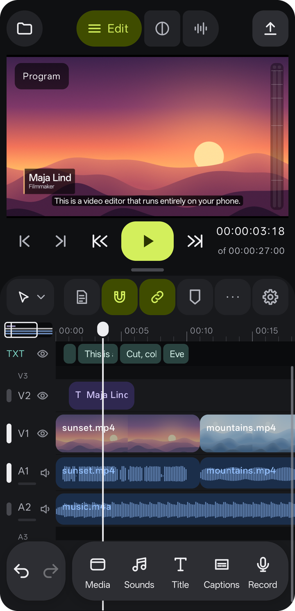
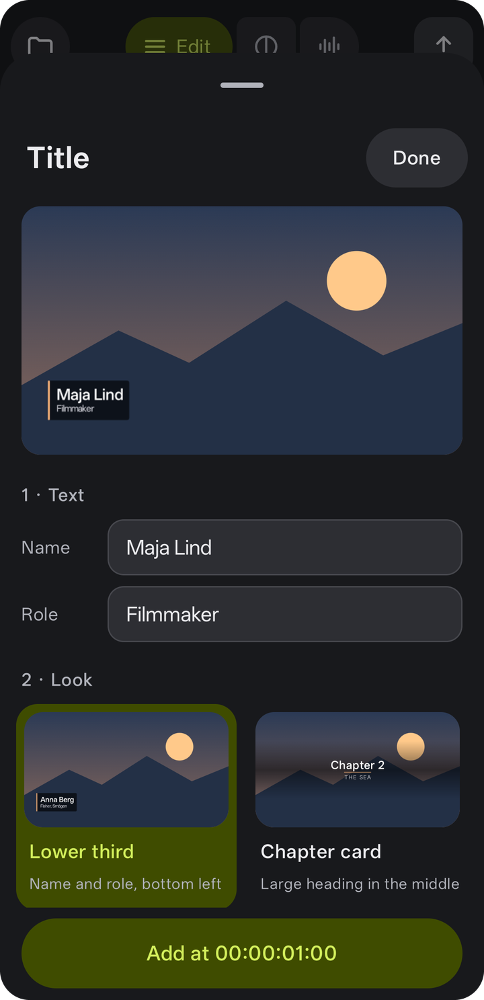
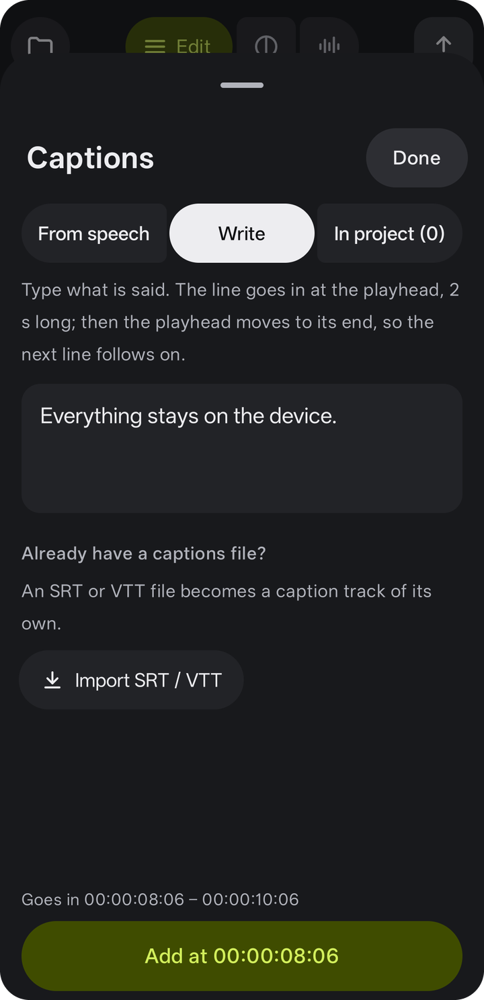
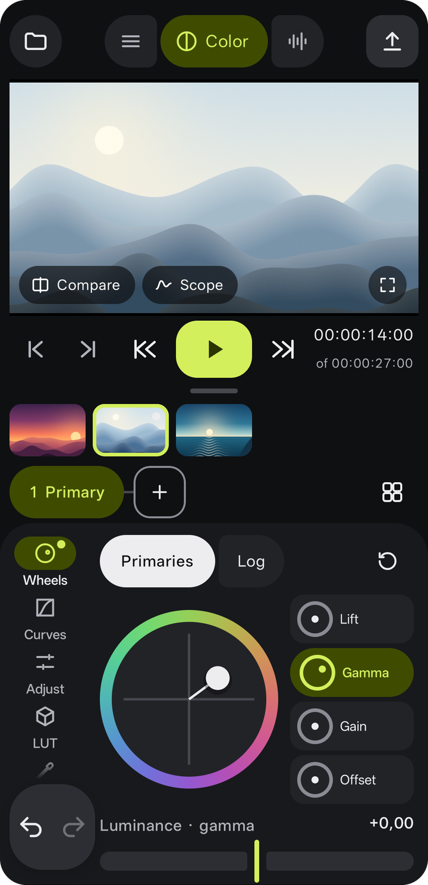

# 🎬 Klipp

A multi-track video editor for Android phones, built for touch. A Kotlin/Jetpack Compose app on top of the
[FilmCraft](https://github.com/storytold/filmcraft) editing engine (Rust, via JNI); playback and export with Media3.

<p align="center">
  
  
  
  
</p>

> 🚧 **Status:** a hobby project in active development. Android 10+ (arm64). Tested on a **vivo X300 Ultra** and a
> **OnePlus 12**. It comes with **no warranty** – keep copies of footage you care about. Support is best effort.

🐞 **Found a bug or missing something?** [Report a bug or suggest a feature](https://github.com/Flabbjaxaren/klipp/issues/new/choose)
– there are short forms for both.

## 📲 Install

Download `Klipp-<version>.apk` from [Releases](https://github.com/Flabbjaxaren/klipp/releases/latest) and open it on
the phone (allow installing from your browser or file manager when Android asks). Updates install over the old
version and keep your projects. Requires Android 10+ on a 64-bit ARM phone.

## ✨ Features

- ✂️ **Editing:** up to six video and ten audio tracks, insert/overwrite from a source monitor, ripple, roll, slip,
  razor, linked audio, compound clips, markers (also on the music's beat), sync by sound (camera + separate recorder),
  undo/redo for everything.
  **Slow-mo** plays a high-frame-rate clip at the project's rate with every frame used once (120 fps in a 24 fps
  project = 20 %), and a new project takes the nearest standard frame rate of a phone clip (59.6 fps → 60).
- 👆 **Touch first:** swipe down through a clip to cut it (slide back up before you let go to cancel), drag any
  edge to trim (with a loupe and a two-frame trim view), long-press to lift, pinch to zoom; scrub on the ruler or the
  picture and slide the finger down for ½, ¼, ⅛ speed; two-finger tap = undo, three = redo, also inside the Add
  sheets.
- 📝 **Text-based editing:** on-device speech recognition (whisper.cpp with voice activity detection; Swedish,
  English and multilingual models in three quality steps) turns the audio into text. In the timeline: delete words to
  cut the video, remove pauses and filler words. In the source monitor (tap a clip in Media): read it as sentences and
  tap the ones you want to insert – one transcript per clip, shared by both. Automatic captions.
- 🎨 **Color:** node-based grading (wheels, curves, qualifiers, power windows with object and face tracking), LUTs,
  scopes, spektrafilm film simulation, OpenDRT, floating point through the whole video chain. Log input from phones and
  cinema cameras: Apple Log, vivo Log, S-Log3, V-Log, LogC3/LogC4, F-Log2, Log3G10, DaVinci Intermediate, ACEScct, T-Log.
- 🎞️ **Video layers:** transitions, titles and templates, captions, blend modes, masks with keyframes and tracking,
  keyframed motion, opacity and volume – linear, easy ease, ease in/out or hold, and a value graph with bezier
  handles (evaluated with the engine's own curve math, so preview and export match). Auto reframe: a clip is zoomed to
  fill the frame and follows the face (e.g. 16:9 footage in a 9:16 project).
- 🎧 **Audio:** volume lines on the clips in the timeline (tap for a keyframe, drag the line or a keyframe, double tap
  to delete), mixer with automation, effects (noise reduction, speech enhance, EQ, compressor …), ducking under
  speech, loudness measurement, voice-over, text to speech (the phone's voices), built-in sound effect packs.
- 📷 **RAW and pro formats:** ProRes import, MotionCam RAW (`.mcraw`) and Cinematic RAW Studio (`.CRAW`) developed on
  the phone into an editable log copy (see Known limitations).
- 📱 **Fits the screen:** the picture follows the project's shape (16:9, 9:16, 4:3 …) and its height is kept per
  shape; in landscape the divider between the picture and the timeline can be dragged (double tap = back). Interface
  size *Normal*, *Compact* or *Small* and a full screen without the system bars in **Settings → Appearance**.
- ⚡ **Performance:** proxies, pre-rendering of heavy parts, render cache, HDR and 10-bit.
- 🔒 **Private:** nothing leaves the phone: speech recognition and all processing run locally, and Klipp collects no
  usage data. The network is only used to download the speech models you ask for.

## 🔬 Experimental features

Turn them on in **Settings → Experimental**. They are off by default; while off, Klipp is the advanced editor on
tracks, as before. Turning them on or off, or switching between them, never changes the project: the same clips,
tracks, effects and undo history in every mode.

- 🐣 **Simple mode:** a second, beginner face on the same editor. The clips as a strip of thumbnails (tap to select,
  drag the edges to trim, hold and drag to reorder, swipe down to cut), and five buttons: **Add**, **Sounds** (sound packs, text
  to speech, ducking under speech, fade out at the end), **Text** (four title styles, 3 s, 5 s or the whole clip),
  **Filter** (look, exposure, contrast, warmth, saturation – for one clip or all) and **Format** (the video's size and
  orientation). **Save video** exports in *Good*
  (Full HD) or *Best* (4K) and can share straight away. Everything in it is an advanced-mode function: work done in
  advanced mode that simple mode has no control for is kept and shown as a mark on the clip. Details in
  [`docs/simple-mode.md`](docs/simple-mode.md).
- 🧲 **Magnetic timeline:** V1 is the storyline. Clips close up when one is deleted or trimmed and make room when one
  is inserted; clips on the other tracks are connected to the storyline clip they hang on and follow it. Lift a clip
  from the storyline, overwrite into it or replace it with a gap clip. It can be chosen for advanced mode; simple mode
  always edits on it.

Turned on, the same page chooses simple or advanced mode and, for advanced mode, tracks or the magnetic timeline. Both
may still change between versions – feedback in Issues is welcome.

## 💛 Support Klipp

Klipp is free, open source and ad-free, built in my spare time. If you enjoy it and want to support further
development, any contribution is greatly appreciated!

<p>
<a href="https://www.paypal.me/gendutklipp"></a>
</p>

## 📁 Project layout

- `app/` – the Android app (Compose, Media3 for playback and export)
- `rust/` – `klipp-bridge`, the JNI bridge to FilmCraft (`Session::execute`)
- `app/src/main/cpp/` – the JNI wrappers for whisper.cpp and the RAW developers (built by Gradle with CMake)
- `third_party/` – Media3 effect, transformer and ExoPlayer (modified), whisper.cpp (trimmed), the Cinematic RAW Studio
  and MotionCam decoders – see `THIRD_PARTY.md`
- `tools/` – the FFmpeg build, the spektrafilm table export, the regression run (`tools/regress`), the source package

## 🌍 Languages

English (default) and Swedish. Translations live in `app/src/main/res/values-*/` (Swedish in `values-sv/`); the
app language can be chosen per app in the system settings (Android 13+).

## 🎞️ Video layers

- **Export:** Media3 Transformer with the multi-layer compositor (`LayerCompositor`): the top video track down to V1
  plus cross dissolve layers, titles and captions as overlays (`TimedOverlay`), templates and animations in `Titles.kt`.
- **Preview:** Media3's CompositionPlayer doesn't support multiple video sequences yet, so the main player shows the
  bottom layer and `UpperLayers` draws the upper layers (their own muted ExoPlayers in a TextureView, synced to the
  playhead), titles and captions on top. While you drag a slider, `LivePreview` draws a still frame.
- Long-press "Program" in the viewer for a diagnostics view.

## 🛠️ Building

Requirements: Android Studio (or SDK + JDK 21), Rust (rustup), Android NDK.

1. Install the Rust target and cargo-ndk (once):

   ```
   rustup target add aarch64-linux-android
   cargo install cargo-ndk
   ```

2. Build the Rust bridge into `app/src/main/jniLibs` (about 10–20 min the first time). The built library is not in the
   repository; GitHub Actions builds it on every push (`.github/workflows/build.yml`) and keeps the APK as an artifact:

   ```
   cd rust
   export ANDROID_NDK_HOME=$HOME/Library/Android/sdk/ndk/<version>
   RUSTFLAGS="--remap-path-prefix=$HOME=~" cargo ndk -t arm64-v8a --platform 29 -o ../app/src/main/jniLibs build --release
   ```

3. Build the ProRes import's library (FFmpeg's ProRes decoder + Klipp's wrapper, `libklipp_prores.so`) into the same
   folder – it downloads the pinned FFmpeg release and checks its SHA-256 (a minute or two; CI builds it too):

   ```
   tools/ffmpeg/build.sh
   ```

4. Open the project in Android Studio and run, or build from the terminal (Gradle builds the C++ parts – whisper.cpp
   and the RAW developers – itself):

   ```
   ./gradlew assembleDebug
   ```

### 🔑 Signing

Android only updates an installed app with an APK signed by the same key. The release build reads its key from
`~/.klipp/keystore.properties` (outside the repository; or a file named by the `KLIPP_KEYSTORE` environment variable):

```
storeFile=/path/to/klipp-release.jks
storePassword=…
keyAlias=klipp
keyPassword=…
```

Without it (e.g. on CI) the release build is signed with the debug key. `-Pklipp.debugSigned=true` forces the debug key,
to update an install that was signed with it. Keep the key and its password backed up – without them no update can
replace an installed Klipp.

## ⚠️ Known limitations

- MotionCam RAW `.mcraw` video: in the video picker, tap **MotionCam RAW** and choose MotionCam's folder once (usually
  `Documents/MotionCam`). Klipp develops each take on the GPU into a 10-bit HEVC log copy with its sound; a quick
  half-size copy goes on the timeline first and the full one replaces it by itself. **MotionCam RAW development** on
  the Color page develops it again with another log or exposure index. MotionCam clips start with an OpenDRT node
  from the log they are developed into, as CRAW clips do. Thanks to Paulo Gonçalves ([@utalpt](https://github.com/utalpt)) for
  the developer this is built on.
- Cinematic RAW Studio `.CRAW` video opens through **Import → Files app** on devices with a compatible
  10-bit HEVC encoder. Klipp develops an editable log copy with AAC audio when present and keeps the source
  linked. The editing copy is scaled to fit the encoder when needed. Use **CRAW development** on the Color
  page to choose a different log profile or exposure index and develop the clip again in place.
- Clips imported through the system photo picker get generic names (e.g. `28.mp4`) – Android hides the file names.
- Projects live inside the app: back them up with their media (Projects → long-press → Back up to a folder… or Save a
  project package with media…) before uninstalling Klipp or moving to another phone.
- vivo Log has no published specification; its curve was measured and its colors fitted to vivo's own vivo Log →
  Rec.709 LUT.
- Speech recognition runs on the CPU (the GPU path was tried and dropped: unstable drivers, slower on phones).
- HLG export works, but the preview on the phone stays SDR.

## 🧪 Tests

- Rust (the bridge against real files): `KLIPP_TEST_MEDIA=<folder> cargo test --release` – the folder needs
  `klipp_a.mp4`, `klipp_b.mp4`, `tal.m4a`, `three.mov` and `df_noise.wav`; the workflow shows how to generate them with
  ffmpeg.
- Kotlin (gestures, snapping, ripple, the Rust → Kotlin contract, video layers, properties, screenshots):
  `./gradlew testDebugUnitTest` and `./gradlew recordRoborazziDebug`
- GPU (on a connected phone): the film and the grade nodes rendered by the phone's GPU, as playback runs them, against
  the CPU path: `./gradlew connectedGpuTestAndroidTest`. They run in their own app (`se.gendut.klipp.gputest`), so
  the installed Klipp and its projects are never touched.
- Regression run (on a connected phone, through the app's agent bridge): frame-exact playback and export checks in a
  project of their own – see `tools/regress/README.md`.

The FilmCraft version is pinned in `rust/Cargo.toml` (`rev`). Update it deliberately.

## 📜 License

Klipp is free software: as distributed, the app and this repository as a whole are offered under the **GNU General
Public License, version 3 only** (`GPL-3.0-only`, see `LICENSE` and `docs/licensing.md`); the JNI bridge's own code
(`rust/`) is `GPL-3.0-or-later`. Everything
it contains or downloads from other projects, with licenses and changes, is listed in **`THIRD_PARTY.md`**; the full
inventory, license texts and notices are in **`LICENSES/`** and in the app (Settings → About → Licenses and source code).
Each release's Corresponding Source: `docs/source-release.md`.

Parts from other projects:

- **spektrafilm** (Andrea Volpato et al., https://github.com/andreavolpato/spektrafilm) – spectral film simulation,
  GPL-3.0. The color pipeline is ported to `app/src/main/java/se/gendut/klipp/engine/Spektra.kt`; the tables in
  `app/src/main/assets/spektrafilm` are computed with spektrafilm's code (`tools/spektrafilm/export_tables.py`).
  The film profiles and everything that encodes them (tables, LUTs) are **CC BY-SA 4.0** – see
  `app/src/main/assets/spektrafilm/SPEKTRAFILM_LICENSE.txt`. The spectral upsampling tables behind the film tables are
  Klipp's own (`tools/spectra`, after Jakob & Hanika 2019).
- **OpenDRT** (Jed Smith, https://github.com/jedypod/open-display-transform) – GPL-3.0, in `engine/OpenDrt.kt`.
- **FilmCraft** (the editing engine, Rust), **Media3** (Apache-2.0), **whisper.cpp** (MIT), **FFmpeg** (LGPL-2.1+,
  only its ProRes decoder and MOV reading/writing, for the ProRes import).
- **DeepFilterNet** (noise reduction and speech enhance), **MediaPipe** and **YuNet** (face following), **Beat This!**
  (beat markers), **ONNX Runtime** (word edges, beat markers), **Silero VAD**, the **Cinematic RAW Studio** and
  **MotionCam** decoders – licenses in `THIRD_PARTY.md`.
- **Media3 effect** (Apache-2.0) as source code in `third_party/media3-effect`, modified so that the whole video chain
  computes in floating point (RGBA16F) – see `third_party/media3-effect/KLIPP.md`.
- **Media3 transformer** (Apache-2.0) as source code in `third_party/media3-transformer`, modified for live playback's cuts
  with one video renderer – see `third_party/media3-transformer/KLIPP.md`.
- **Media3 ExoPlayer** (Apache-2.0) as source code in `third_party/media3-exoplayer`, modified so a clip ending before an
  open GOP's keyframe keeps its last frames – see `third_party/media3-exoplayer/KLIPP.md`.

### The spektrafilm tables

```
python -m venv venv && venv/bin/pip install numpy scipy colour-science scikit-image opt-einsum numba matplotlib \
    exiv2 rawpy lensfunpy OpenImageIO pyfftw
git clone https://github.com/andreavolpato/spektrafilm
venv/bin/python tools/spektrafilm/export_tables.py spektrafilm/src app/src/main/assets/spektrafilm reference.json
```

`reference.json` (every stage for a few films and settings) is used by `SpektraTest` – copy it to
`app/src/test/resources/spektrafilm_ref.json`.
